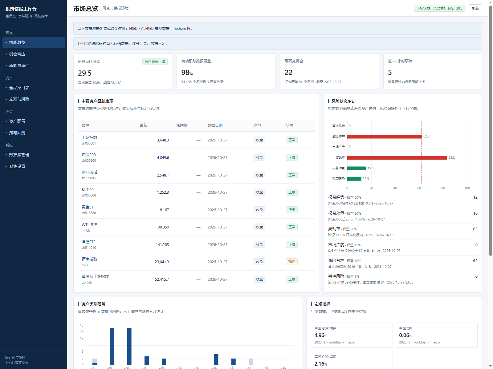
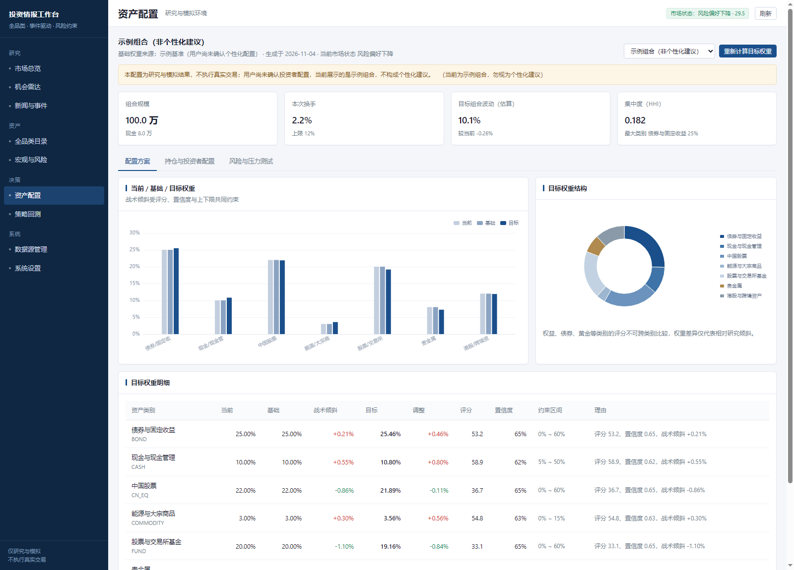
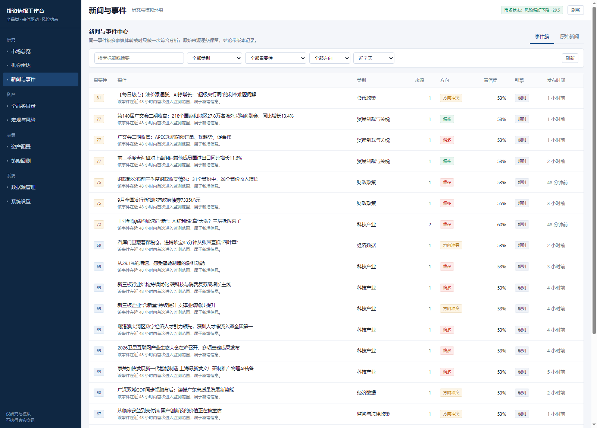
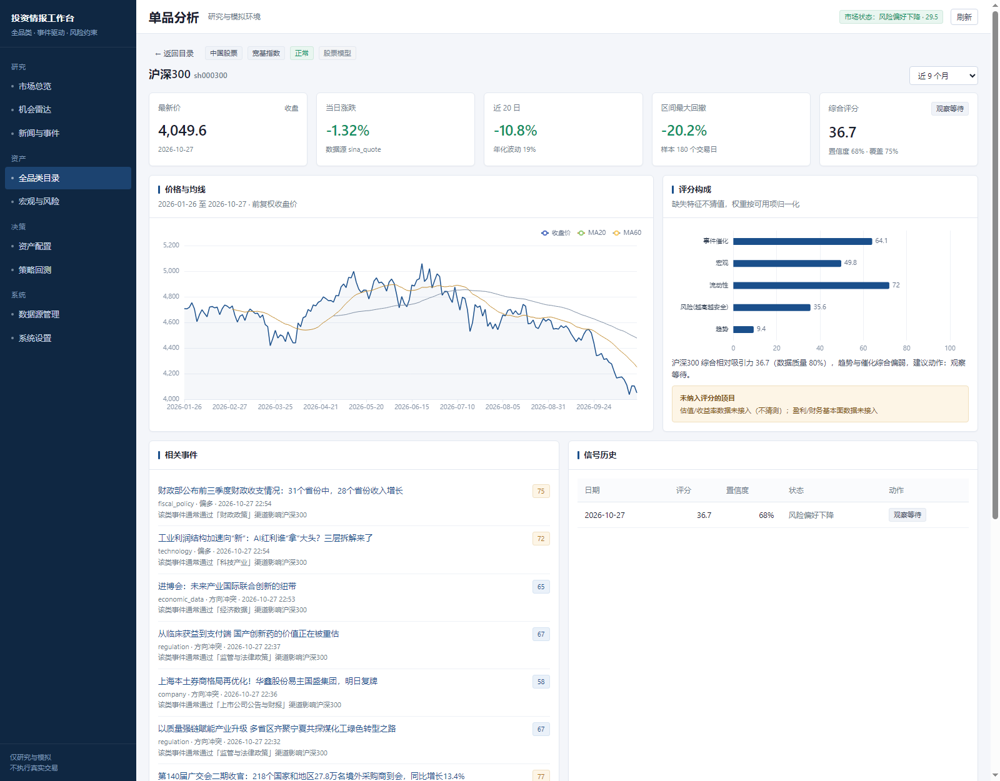

# 投资情报与动态资产配置系统

面向中国境内个人投资者的**个人投资研究工作台**：采集真实公开数据 → 去重聚类新闻 → 事件分析 → 资产评分 → 风险状态 → 跨资产配置建议 → 历史回测。

> 本系统只做研究、风险提示与模拟配置，**不接入券商、不自动下单**。所有评分、方向判断与权重建议均不构成投资建议。

---

## 1. 能力概览

| 模块 | 已实现 |
| --- | --- |
| 全品类目录 | 12 个一级类别（现金、中国股票、基金、债券、贵金属、商品、衍生品、港股与跨境、REITs、银行理财、保险、房地产）+ 二级类别，60+ 登记品种，含「正常/延迟/缺失/人工维护/受限/待核验」六种数据状态 |
| 数据采集 | 新浪行情（A 股/ETF/港股/美股指数/COMEX 贵金属与原油/人民币汇率）、东方财富日线与新闻、世界银行宏观；FRED / Tushare / AKShare / GDELT 为可选适配器，缺密钥或缺依赖时明确显示原因 |
| 新闻与事件 | 规范化 → 标题/内容哈希去重 → 相似度聚类 → 规则分类 → 重要性与置信度 → 证据链 → 传导路径 → 资产关联 → 结论版本快照 |
| 资产评分 | 按类别独立配置权重与特征，缺失特征不猜值，扣除权重并降低数据质量/置信度；输出 7 种建议动作，数据不足时「暂不判断」 |
| 风险状态 | 权益趋势、动量、波动率、市场广度、避险资产、事件风险六维加权；覆盖不足返回「数据不足」 |
| 资产配置 | 基础权重 + 战术倾斜 → 有上下界单纯形投影（同时满足类别上下限与总和为 1）→ 换手上限 → 最小交易阈值；含波动率、相关性、压力测试 |
| 回测 | 真实前复权日线，按调仓日截断数据避免前视偏差，含成本、换手、样本内外拆分，数据不足时明确失败 |
| AI | OpenAI 兼容统一适配层，低成本/高能力模型分层、缓存、Token 与费用统计、日/月预算、失败降级为规则引擎 |
| 运维 | APScheduler 定时任务（新闻/行情/宏观/事件/评分/配置/简报/健康检查/成本统计）、任务运行记录、通知去重、数据源健康状态 |

前端为响应式中文 Web 工作台（Vue 3 + Vite + TypeScript + ECharts），共 10 个页面。

## 2. 目录结构

```text
InvestWeb/
├── backend/
│   ├── app/
│   │   ├── api/            # REST 路由（catalog / market / news_events / portfolio / backtest / ops）
│   │   ├── providers/      # 数据源适配器（sina / eastmoney / worldbank / fred / gdelt / tushare / akshare）
│   │   ├── models/         # SQLAlchemy 模型（24 张表）
│   │   ├── services/       # 采集、事件引擎、评分、风险状态、配置、回测、通知
│   │   ├── ai/             # 模型适配层与事件 AI 分析
│   │   ├── jobs/           # APScheduler 任务编排
│   │   └── core/           # 配置、数据库、时间工具
│   ├── tests/
│   └── requirements.txt
├── frontend/               # Vue 3 + Vite + TS + ECharts
├── config/                 # 资产类别、品种、数据源、信号规则、风险约束（YAML，可扩展）
├── docs/                   # 架构、数据源、数据库、状态、测试、部署、已知问题
├── data/                   # SQLite 数据库与运行数据（不入库）
├── scripts/
├── .env.example
├── Dockerfile / docker-compose.yml
└── start.ps1
```

## 3. 本机启动

**要求**：Python 3.11+、Node.js 18+。

```powershell
# Windows 一键启动（开发模式：后端 8000 + 前端 5173）
.\start.ps1

# 单端口模式：构建前端后由后端托管，访问 http://127.0.0.1:8000
.\start.ps1 -Prod
```

手动启动：

```bash
python -m venv .venv
.venv/Scripts/python -m pip install -r backend/requirements.txt
copy .env.example .env                      # Windows
.venv/Scripts/python -m uvicorn app.main:app --host 127.0.0.1 --port 8000 --app-dir backend

cd frontend && npm install && npm run dev   # 另开终端
```

首次启动会自动：创建数据库 → 写入资产目录/数据源/示例组合 → 启动定时任务。

**脚本报错时的兜底**：`start.ps1` 必须保存为 UTF-8 with BOM。若被编辑器改存成无 BOM 的 UTF-8，
PowerShell 5.1 会按系统 GBK 解码中文，报 `ParserError: Unexpected token`。此时不必修脚本，
直接绕过它启动后端即可（前端另开终端 `npm run dev`）：

```
.\.venv\Scripts\python.exe -m uvicorn app.main:app --host 127.0.0.1 --port 8000 --app-dir backend
```

脚本本身会校验 Python 版本：机器上若同时装了 Python 2.7，`python` 命令可能指向 2.7，
脚本会跳过它并明确报错，不会用错误版本创建虚拟环境。已有 `.venv` 时以 `.venv` 为准。

**首次使用建议顺序**：`数据源管理` → 宏观刷新 → 日线历史 → 行情 → 新闻采集 → `系统设置` 或任务面板运行「资产评分更新」→ 查看机会雷达与资产配置。

## 4. 配置

所有密钥只从环境变量读取，不写入数据库、不返回前端。复制 `.env.example` 为 `.env` 后按需填写：

| 变量 | 作用 | 不配置的后果 |
| --- | --- | --- |
| `FRED_API_KEY` | 美国利率/通胀/美元等日频宏观 | 宏观仅有世界银行年度数据，状态显示未配置 |
| `TUSHARE_TOKEN` | Tushare Pro 适配器 | 适配器显示缺少密钥，其他数据源正常 |
| `GDELT_ENABLED=1` | 全球新闻发现 | 默认关闭 |
| `LLM_ENABLED` / `LLM_API_KEY` / `LLM_BASE_URL` / `LLM_MODEL_*` | 事件 AI 分析 | AI 显示未配置，规则引擎继续工作，不产生伪造结论 |
| `LLM_DAILY_BUDGET_USD` / `LLM_MONTHLY_BUDGET_USD` | 预算上限 | 默认 0.5 / 10 美元，超限自动跳过 AI 调用 |
| `WEBHOOK_URL` | 通知外发 | 仅站内消息 |
| `DATABASE_URL` | 数据库连接 | 默认本地 SQLite |

## 5. 界面

| 市场总览 | 资产配置 |
| --- | --- |
|  |  |

| 事件证据链 | 单品分析 |
| --- | --- |
|  |  |

更多截图见 `docs/screenshots/`。

## 6. 文档

- [架构说明](docs/ARCHITECTURE.md)
- [数据源与权限](docs/DATA_SOURCES.md)
- [数据库设计](docs/DATABASE.md)
- [实施状态](docs/IMPLEMENTATION_STATUS.md)
- [测试报告](docs/TEST_REPORT.md)
- [部署说明](docs/DEPLOYMENT.md)
- [已知问题与限制](docs/KNOWN_LIMITATIONS.md)

## 7. 免责声明

本项目为个人研究工具。数据来自公开接口，可能存在延迟、缺失、修订或错误；事件方向、评分、置信度与配置建议均为辅助研究信息，不构成任何投资建议或收益承诺。真实交易决策与后果由用户自行承担。
